# OnlineCasino

## Some of the screens

  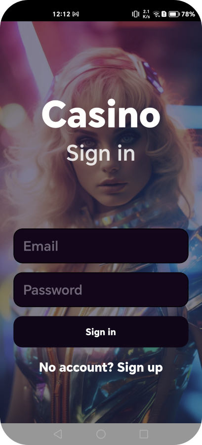
  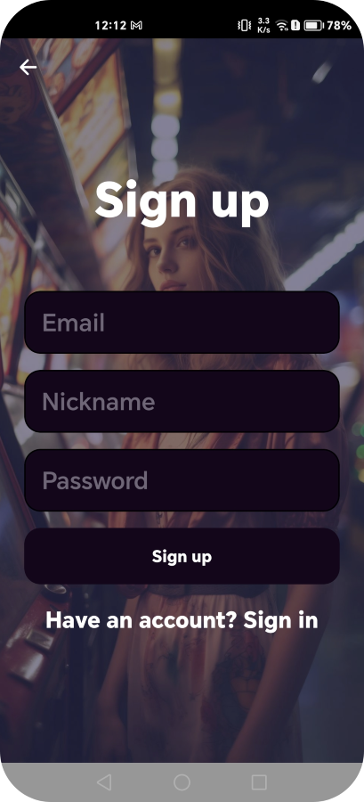
  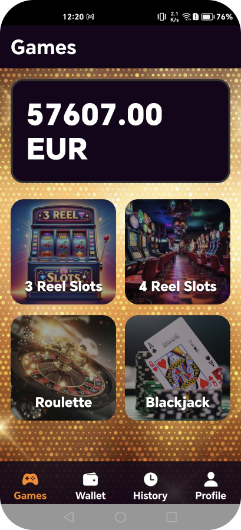
  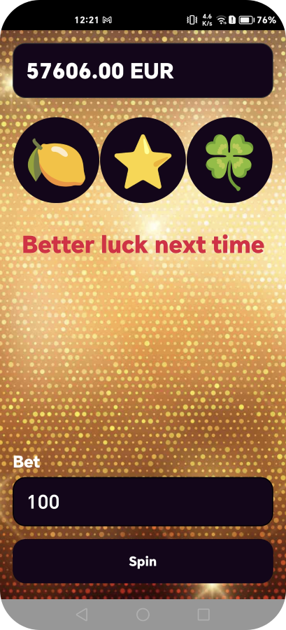
  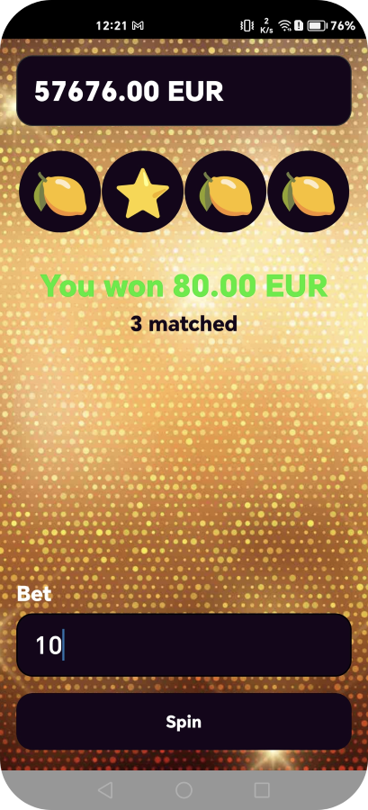

  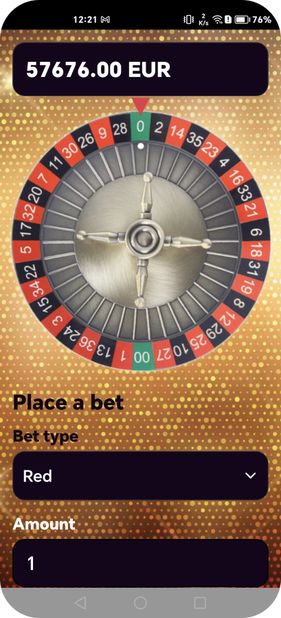
  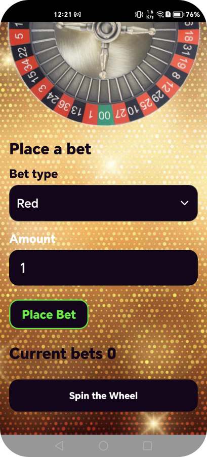
  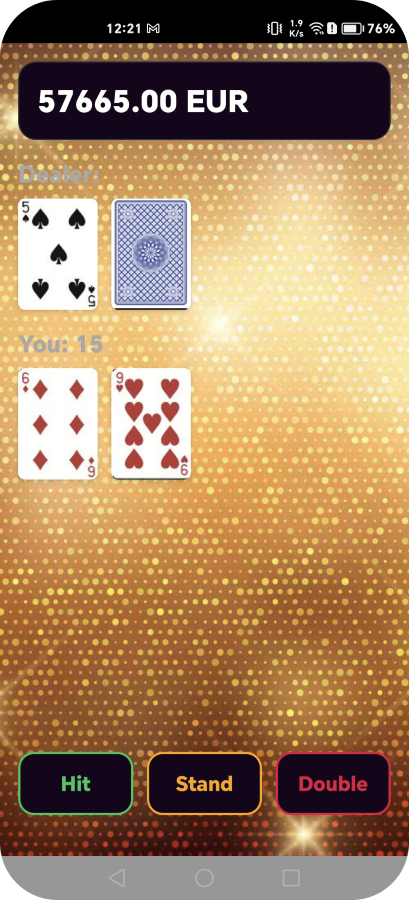
  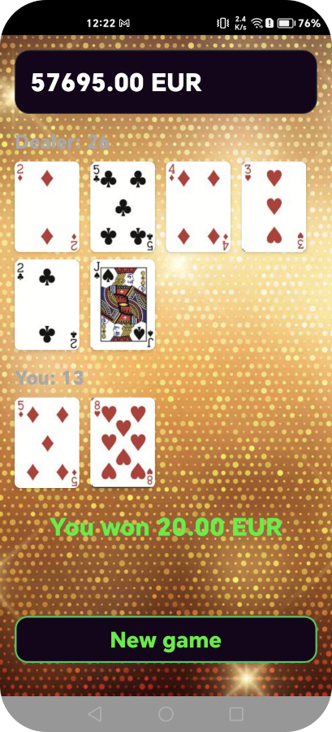
  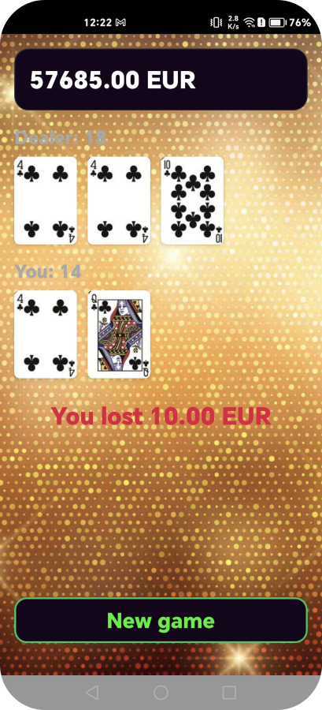

  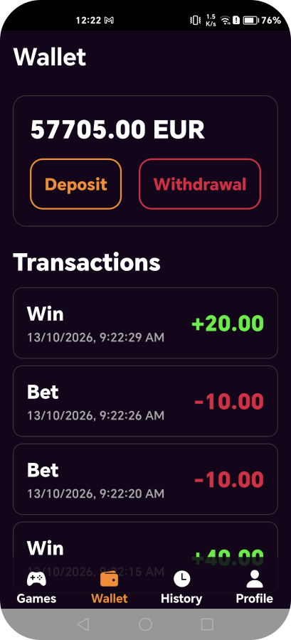
  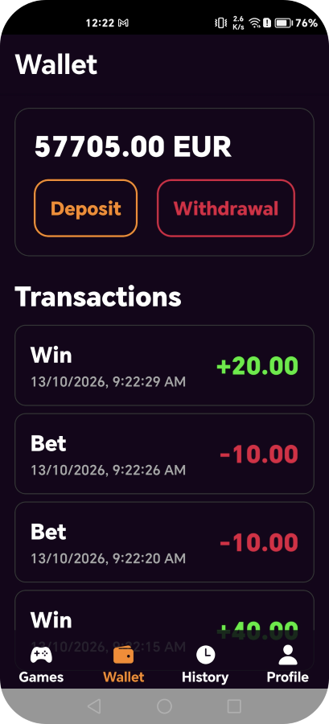
  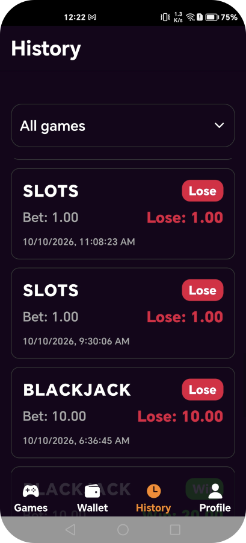
  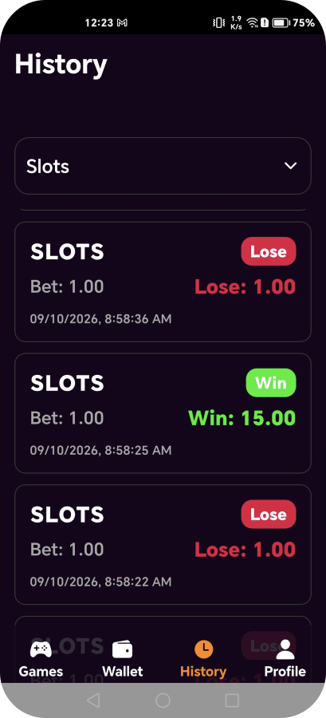
  

  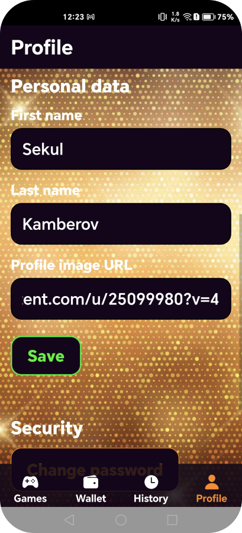
  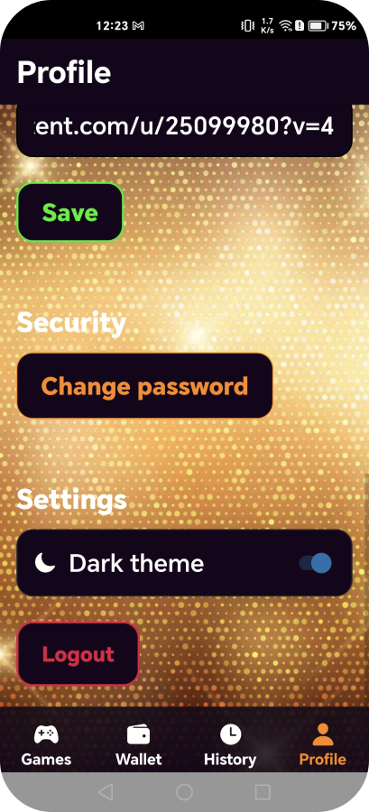
  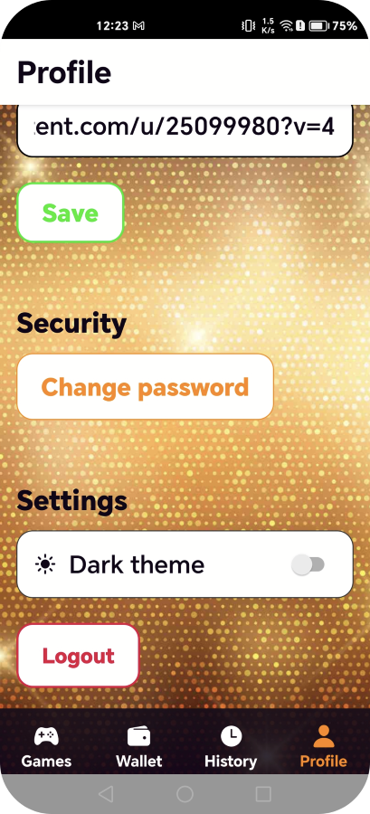
  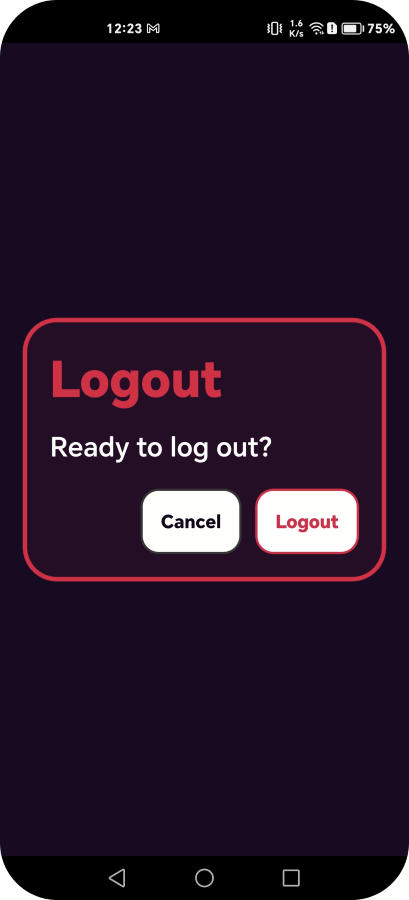
  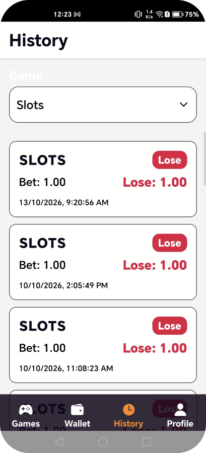

  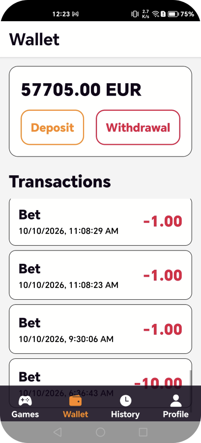

A full-stack casino gaming application built with React Native, Expo and TypeScript on the frontend, and ASP.NET Core 10 with Entity Framework Core and SQLite on the backend.

## Overview

OnlineCasino is a mobile-first gaming platform that includes a full casino experience:
authentication, wallet management, game history, user profiles and three fully playable games
(Slots, Roulette, Blackjack). The mobile app talks to a .NET 10 REST API that handles all business logic,
game rules and persistence.

The project is built with a strong emphasis on testability, type safety and clean separation between UI, business logic and data access.

Both the frontend and backend are fully documented. The backend exposes interactive API documentation through Swagger UI, and the frontend is documented through TypeScript types, JSDoc comments on hooks and components, plus the test suite that acts as executable documentation for every screen and hook.

## Tech Stack

| Layer               | Technology                                     |
| ------------------- | ---------------------------------------------- |
| Mobile framework    | React Native 0.86.3                            |
| Runtime             | Expo SDK 57.0.25                               |
| Language (frontend) | TypeScript 6.0 (strict)                        |
| Routing             | Expo Router 57.0.23 (file-based, typed routes) |
| State / data        | TanStack Query v5.104                          |
| Secure storage      | Expo Secure Store 57.0.4                       |
| Backend             | ASP.NET Core 10                                |
| Language (backend)  | C# 13                                          |
| ORM                 | Entity Framework Core 10                       |
| Database            | SQLite                                         |
| Container           | Docker + Docker Compose                        |
| Frontend testing    | Jest 30 + React Native Testing Library 14      |
| Backend testing     | xUnit + EF Core                                |
| CI                  | GitHub Actions                                 |

## Mobile App

The mobile app is built with **React Native 0.86.3** and **Expo SDK 57.0.25**. It is a single codebase that runs on iOS, Android and the web through Expo's unified runtime.

## Backend

The backend is an **ASP.NET Core 10 Web API** that exposes REST endpoints for authentication, wallet, games and user data. It uses **Entity Framework Core 10** with **SQLite** for persistence and cookie-based authentication for session management.

Key points:

- ASP.NET Core 10 with minimal hosting model
- Entity Framework Core 10 with SQLite provider
- Cookie authentication
- Service layer with a `Result<T>` type for consistent success / failure handling
- Game engines for Slots, Roulette and Blackjack with server-side validation and payout logic
- xUnit test project with unit and integration tests

## Features

- Email + password authentication with secure session storage
- Wallet with deposit, withdrawal and transaction history
- User profile
- Game history with filtering
- Three fully playable games:
  - Slots - configurable reels, bet validation, optimistic balance, animated spin, match payouts
  - Roulette - multiple bet types (red / black / even / odd / low / high / dozen / number), bet list, spin lifecycle, win / lose / push results
  - Blackjack - bet, start, hit, stand, double, win / loss / push results
- REST API with proper HTTP status codes, authentication cookie, validation and error results
- Full API documentation with Swagger UI at http://localhost:8080/swagger

## Requirements

| Tool             | Version                                 |
| ---------------- | --------------------------------------- |
| Node.js          | 20.x or newer (recommended 20 LTS)      |
| npm              | 10.x or newer                           |
| .NET SDK         | 10.0                                    |
| Docker           | Latest (required for backend container) |
| Docker Compose   | v2 or newer                             |
| TypeScript       | 6.0 (installed via npm)                 |
| Expo SDK         | 57.0.25                                 |
| React Native     | 0.86.3                                  |
| Git              | Latest                                  |
| iOS Simulator    | Xcode 15+ on macOS                      |
| Android Emulator | Android Studio with API 34+             |
| SQLite           | Bundled with EF Core provider           |

Optional:

- Expo Go app on a physical device for quick testing
- Visual Studio 2025 or JetBrains Rider for backend development

## API Documentation

The backend exposes full interactive API documentation with Swagger UI.

After starting the backend, open: http://localhost:8080/swagger

## Getting Started

cd OnlineCasino

docker compose build

docker compose up -d

Verify the backend is running
http://localhost:8080

npx expo start

Scan the QR code and enjoy
